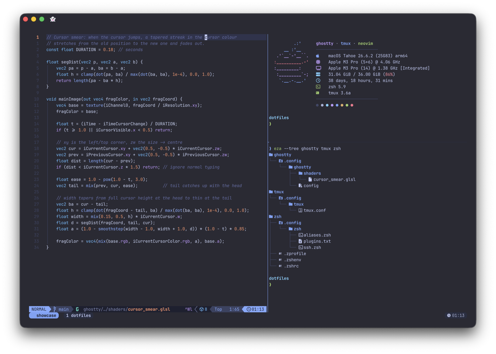
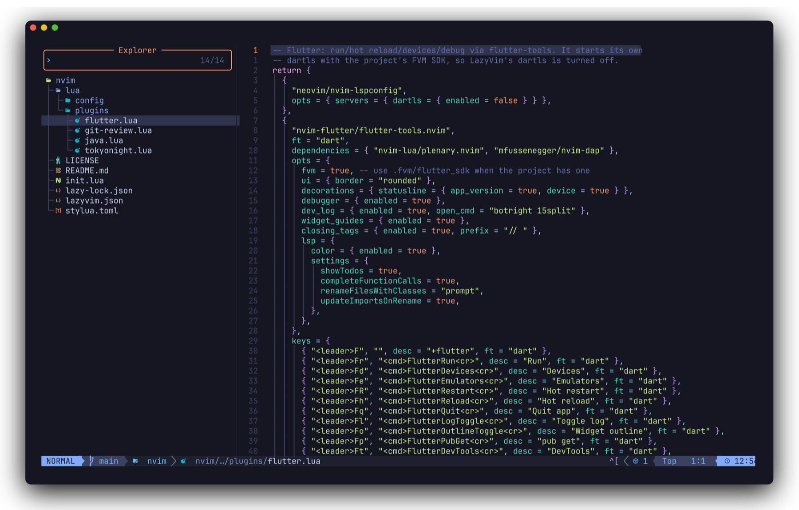
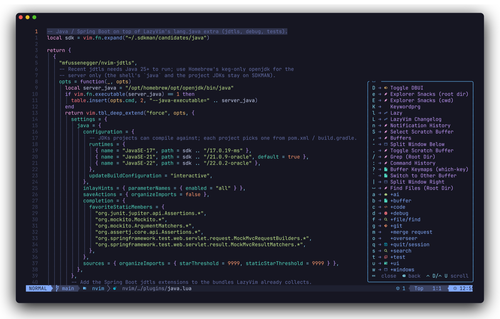
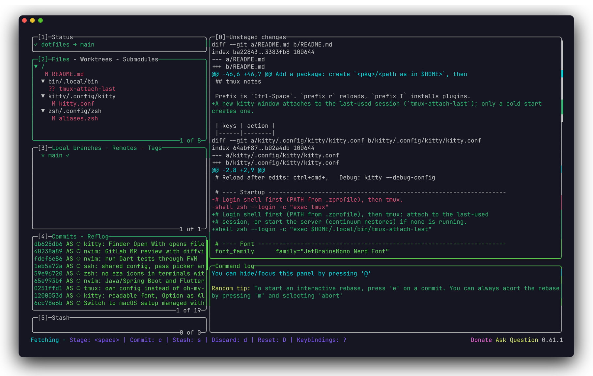

<h1 align="center">dotfiles</h1>

<p align="center">
  A keyboard-only macOS dev setup for Flutter and Spring Boot:<br/>
  <b>Ghostty</b> → <b>zsh</b> → <b>tmux</b> → <b>Neovim</b>, linked into <code>$HOME</code> with GNU stow.
</p>

<p align="center">
  
  
  
  
  
  
  
</p>

<p align="center">
  
</p>

<p align="center">
  
</p>

## ✨ What's inside

- **Neovim as the IDE.** LazyVim on Neovim 0.12 with LSP, debugger, test runner and
  task runner for the two stacks I work in:
  - **Java / Spring Boot**: jdtls with Lombok, java-debug, java-test and the Spring Boot
    language server (bean and property navigation in `application.yml`).
  - **Flutter**: flutter-tools with the project's FVM SDK, hot reload, device picker,
    widget outline, tests through `fvm flutter test`.
  - **Code review in the editor**: diffview for branch-vs-target diffs and gitlab.nvim
    for merge requests: discussions, line comments, suggestions, approve, pipeline.
  - **AI**: Claude Code next to the code (`claudecode.nvim`).
- **tmux as the window manager.** One session per project picked with fzf, panes that
  share `Ctrl-h/j/k/l` with Neovim splits, sessions saved and restored across reboots,
  lazygit in a popup. New terminal windows land back in the last session.
- **zsh that starts in ~0.1 s.** antidote instead of oh-my-zsh, fzf-tab completion,
  autosuggestions, syntax highlighting, zoxide, eza, bat, starship, lazy-loaded SDKMAN.
- **Ghostty with no tabs of its own.** JetBrains Mono Nerd Font, Option as Alt, Tokyo Night,
  blur, a cursor-smear GLSL shader,
  a pill-style tmux bar and a fastfetch config for screenshots.
- **Finder → Neovim.** **Open With → Open in Neovim** (a small AppleScript droplet built
  by `install.sh`) opens files in Neovim inside tmux, shows images inline (chafa) and
  runs scripts. kitty's config stays as a fallback and uses the same handler.
- **SSH from the password store.** `s` fuzzy-picks a host from `pass`, and
  `ssh-hosts-from-pass` turns the same entries into `~/.ssh/config` hosts.
  No hostnames or keys in this repo.
- **Claude Code that loads only what a task needs.** Global rules in `~/.claude/CLAUDE.md`,
  a status line showing the work/personal profile, and skills grouped into plugin kits that are
  switched on per project (mobile skills only in Flutter repos, design skills on demand), so every
  session starts with fewer tokens. Memory and settings live in a private companion repo.

## 📸 Screenshots

<table>
  <tr>
    <td width="50%"></td>
    <td width="50%"></td>
  </tr>
  <tr>
    <td align="center"><code>Space</code> and a pause: every key in which-key</td>
    <td align="center">lazygit in a tmux popup (<code>prefix g</code>)</td>
  </tr>
</table>

## 🚀 Install on a new Mac

```bash
git clone https://github.com/keepggoingg/dotfiles.git ~/dev/personal/dotfiles
~/dev/personal/dotfiles/install.sh
```

`install.sh` runs `brew bundle`, installs SDKMAN, TPM and the tmux plugins, moves any
conflicting files to `~/.dotfiles-backup/<date>/`, stows every package and builds
`Open in Neovim.app`.
Then put your git name and email in `~/.gitconfig.local`:

```ini
[user]
	name = Your Name
	email = you@example.com
```

## 🗂 Layout

Each top-level folder is a stow package mirroring `$HOME`:

| package  | what |
|----------|------|
| `zsh`      | `.zshenv`, `.zprofile` (PATH), `.zshrc`, `.config/zsh/` |
| `ghostty`  | `.config/ghostty/` config, cursor-smear shader |
| `fastfetch`| `.config/fastfetch/config.jsonc` |
| `btop`     | `.config/btop/` config + `tokyo-night-term` theme |
| `kitty`    | `.config/kitty/` fallback terminal config |
| `tmux`     | `.config/tmux/tmux.conf` (own config, TPM plugins) |
| `nvim`     | `.config/nvim` (LazyVim) |
| `ideavim`  | `.ideavimrc` |
| `starship` | `.config/starship.toml` |
| `git`      | `.gitconfig` (identity in `~/.gitconfig.local`), `.config/git/ignore` |
| `direnv`   | `.config/direnv/direnv.toml` |
| `bin`      | `.local/bin/`: `tmux-sessionizer`, `tmux-attach-last`, `term-open`, `ssh-hosts-from-pass` |
| `ssh`      | `.ssh/config` defaults; hosts go in `~/.ssh/config.d/` |
| `claude`   | `.claude/CLAUDE.md` (imports a private `CLAUDE.private.md`), `.local/bin/claude-statusline` |

`macos/` is not a stow package: `build-open-in-neovim.sh` compiles the Finder droplet
into `~/Applications`.

Add a package: create `<pkg>/<path as in $HOME>`, then run
`stow --target ~ <pkg>` from the repo root.

## ⌨️ Keys

<details>
<summary><b>zsh</b></summary>

- Plugins: antidote, list in `zsh/.config/zsh/plugins.txt`. Updates only on `antidote update`.
- SDKMAN is not sourced at startup; its `current` Java/Maven are on PATH and `sdk`
  loads it on first use.
- Machine-only settings and secrets go in `~/.zshrc.local` (not in the repo).

| keys | action |
|------|--------|
| `Ctrl-R` / `Ctrl-T` / `Alt-C` | history / files / dirs (fzf) |
| `Ctrl-Y` | accept suggestion |
| `z` / `zi` | jump to a folder (zoxide) |
| `t` | pick a project, open its tmux session |
| `s` | pick an SSH host from pass |

</details>

<details>
<summary><b>tmux</b> (prefix <code>Ctrl-Space</code>)</summary>

`prefix r` reloads, `prefix I` installs plugins. A new Ghostty window attaches to the
last-used session (`tmux-attach-last`); only a cold start creates one.

| keys | action |
|------|--------|
| `prefix f` / `t` in zsh | pick a repo under `~/dev`, switch to its session |
| `prefix s` / `Shift-Tab` | session list / last session |
| `prefix -` / `_` (or `"` / `%`, `\|`) | split below / right, same folder |
| `Ctrl-h/j/k/l` | move between tmux panes and nvim splits |
| `prefix +` | zoom pane |
| `prefix g` | lazygit popup |
| `prefix Enter`, `v`, `y` | copy mode, select, copy to macOS clipboard |
| `prefix C-s` / `C-r` | save / restore sessions (also autosaved every 15 min) |
| right-click / `Shift`+right-click | tmux menu (copy, paste, split, zoom, lazygit, projects, close) / Ghostty's own menu |

</details>

<details>
<summary><b>Neovim</b> (leader <code>Space</code>)</summary>

LazyVim with extras for Java, Dart, SQL, YAML, Python, Docker, TypeScript, plus
debugger (nvim-dap), tests (neotest) and tasks (overseer).

- Java: jdtls itself runs on Homebrew `openjdk` (needs 25+); projects compile with the
  SDKMAN JDKs listed in `lua/plugins/java.lua`.
- Flutter: flutter-tools uses the project's FVM SDK (`.fvm/flutter_sdk`).
- GitLab MRs: gitlab.nvim reads the token from `glab` for the origin host
  (`glab auth login --hostname <host>` once). Its own `gl...` keys work too
  (`g?` in its windows lists them).

| keys | action |
|------|--------|
| `Space Space`, `Space /` | find file, grep |
| `gd` `gr` `gI` `K` | definition, references, implementation, docs |
| `Space ca`, `Space cr` | code action, rename |
| `Space co`, `Space cxv/cxc` | Java: organize imports, extract variable/constant |
| `Space cgs` | Java: go to super method |
| `Space Fr/Fh/FR/Fq` | Flutter: run, hot reload, hot restart, quit |
| `Space Fd/Fe/Fl/Fo` | Flutter: devices, emulators, log, widget outline |
| `Space tr/tt/ts/td` | test nearest / file, summary, debug nearest |
| `Space db/dc/dO/di/du` | breakpoint, continue, step over/into, debug UI |
| `Space oo`, `Space ow` | run a task (mvnw, npm, make...), task list |
| `Space D` | database UI (dadbod) |
| `Space gg` | lazygit |
| `Space gv` / `Space gV` | diff branch vs `origin/development` (diffview) / close |
| `Space gH` | file history (diffview) |
| `Space mm` | pick a GitLab MR (checks out its branch) |
| `Space mr` / `ms` / `md` | review diff / MR description / discussions |
| `Space mc` (visual: lines) / `mS` | comment on line / suggest a change |
| `Space mA` / `mp` / `mo` | approve / pipeline / open in browser |

</details>

<details>
<summary><b>SSH</b></summary>

Hosts live in [pass](https://www.passwordstore.org/): any entry with `/ssh/` in its path,
first line = ssh arguments (`user@host`, optionally `-p`, `-i`, `-J`).

- `s` picks one with fzf and connects; `s web1`, `s acme/prod` match the end of the
  path; extra args go to ssh (`s web1 uptime`). Tab completes entries.
- `ssh-hosts-from-pass` writes `~/.ssh/config.d/pass-hosts` (not in the repo), so plain
  `ssh web1`, `scp file web1:`, `rsync` and `nvim scp://web1//etc/hosts` work.
  Re-run after adding entries.
- Connections are shared per host for 10 minutes (`~/.ssh/cm`): a second tab or scp
  connects instantly. After a VPN switch, `ssh -O exit <host>` drops a stale one.

</details>

## 📄 License

[MIT](LICENSE)
